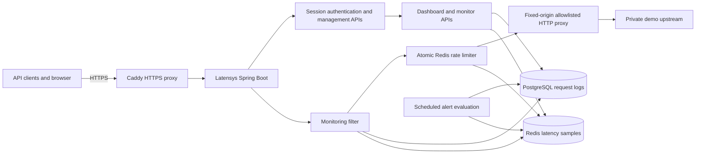

# Latensys

Latensys is a single-upstream API monitoring and rate-limiting application built with Java 17 and Spring Boot. It puts a bounded HTTP gateway in front of an application, records request outcomes, applies atomic Redis sliding-window limits, and shows an authenticated dashboard. The included independent demo service makes the system reproducible without an external API. This v1.0 portfolio release targets one small Linux VM; it is not a multi-tenant SaaS.

## Why it exists

A small API needs answers to three practical questions: what reached the application, what was rejected, and how latency and failures changed recently. Latensys demonstrates those answers with explicit failure behavior, testable database migrations, and a deployable HTTPS boundary.

## Architecture



The browser dashboard polls five management APIs every five seconds. PostgreSQL holds durable request logs and grouped accounting; Flyway owns the schema and bounded cleanup removes old rows. Redis holds transient exact latency samples and the rate-limit sorted sets. Scheduled alerts read metrics independently of dashboard requests. See [architecture and request flows](docs/ARCHITECTURE.md).

**Stack:** Spring Boot 3.4.1, Spring Security, Spring Data JPA, Flyway, PostgreSQL 16.6, Redis 7.4.1, static HTML/CSS/Chart.js, Java 17, Docker Compose, and Caddy.

## Request lifecycle and correctness

`MonitoringFilter` surrounds the request, `RateLimitingFilter` checks the selected policy, then `/app/**` forwards an allowlisted route to the configured origin. Allowed upstream responses, including 4xx/5xx, are recorded once. HTTP 429 is recorded as blocked and never reaches upstream. If Redis cannot decide, Latensys fails closed with HTTP 503 and records the unavailable outcome when PostgreSQL is available. Monitoring storage failures do not alter an otherwise valid upstream response; telemetry can be lost and the error is logged without credentials.

The Lua limiter uses Redis server time. It removes entries outside the sliding window, counts the sorted set, rejects at the configured maximum, or inserts a unique member and sets expiry in one atomic script. Default policy is 50 requests/60 seconds per client and exact path; `/app/hello` defaults to 5/60. Other exact-path overrides are configurable in `application.yml`. Policies are validated at startup and changes require a restart.

Endpoint P95 uses the exact nearest-rank calculation: sort all latency samples in the selected five- or fifteen-minute window and select `ceil(0.95 × n) - 1`. Duplicate durations remain separate samples. Redis keeps a 16-minute TTL and reads filter by timestamp. An empty window returns `null`. Exact calculation costs memory and sorting time proportional to the samples in a window; it is intentionally bounded in scope to this single application.

## Security model

The sole administrator is configured with a username and BCrypt hash through environment variables. Spring Security protects the dashboard, `/monitor/*`, and `/actuator/metrics` with a server-side session; login, logout, and management changes use CSRF protection. The production profile sets the session cookie Secure, HttpOnly, and SameSite=Lax, and disables test controllers. Public `/actuator/health` exposes status without component detail. `/app/**` is public API traffic subject to rate limiting.

Only Caddy publishes ports in the production Compose stack. It overwrites `X-Real-IP` with the connection peer and removes incoming forwarding headers. Latensys accepts that client address only when the socket peer is the pinned Caddy container IP; direct requests ignore spoofed headers. The demo, database, and Redis are on a private internal network. Do not publish Latensys directly or alter the pinned proxy address without updating both Compose and its environment. Historical exposed credentials must be rotated wherever they were used; this release does not rewrite Git history.

The proxy has one configured origin, exact allowed paths, no redirects, and no arbitrary destination selection. It copies only the body, Content-Type, and Accept, with 64 KiB request and 1 MiB response limits by default. Connect timeout defaults to 2 seconds; upstream request and body timeouts default to 5 seconds. It does not support streaming, WebSockets, redirects, or arbitrary forwarded credentials. See [API reference](docs/API.md).

## Local development

Prerequisites: Java 17, Docker Compose, and network access for Maven's first dependency download.

1. Copy `.env.example` to `.env`. Replace the local database password. Generate the administrator BCrypt hash with `htpasswd -nBC 12 admin`, and place only the hash after `admin:` in `ADMIN_PASSWORD_HASH` within single quotes.
2. Run `docker compose up -d --wait` to start local PostgreSQL and Redis. This development file publishes loopback ports only and remains separate from production Compose.
3. Run `./mvnw -f demo-app/pom.xml spring-boot:run` in one terminal. The demo binds to `127.0.0.1:8081` locally.
4. In another terminal, run `set -a; source .env; set +a; ./mvnw spring-boot:run`. Spring Boot does not read `.env` itself.
5. Open `http://localhost:8080/` and sign in. Send `curl http://127.0.0.1:8080/app/hello` and `curl http://127.0.0.1:8080/app/fail` to generate real upstream traffic.

Existing nonempty M0/M1 databases need review, backup, and an explicit Flyway V1 baseline before startup; see [migration instructions](docs/DEPLOYMENT.md#existing-databases). Fresh databases migrate automatically. Do not remove named volumes if you need local data.

## Production Docker installation

Copy `deploy/env.prod.example` to a private `deploy/env.prod`, set a real domain, distinct random database and Redis passwords, and a BCrypt administrator hash. Keep the file outside Git and mode 600. Point DNS at the VM and open TCP 80/443. Then run:

```sh
docker compose --env-file deploy/env.prod -f compose.prod.yaml config --quiet
docker compose --env-file deploy/env.prod -f compose.prod.yaml up -d --build --wait
```

Caddy obtains HTTPS certificates automatically for a reachable domain. The local-only verification profile uses `deploy/Caddyfile.local` and Caddy's internal CA. Full VM, firewall, backup, restore, update, and rollback instructions are in [deployment guide](docs/DEPLOYMENT.md). Public deployment remains pending until a VM and domain are supplied and authorized.

## Configuration and integration

`.env.example` documents local variables; `deploy/env.prod.example` documents production secrets and domain. `DB_URL`, `DB_USERNAME`, `DB_PASSWORD`, `REDIS_HOST`, `REDIS_PASSWORD`, `ADMIN_USERNAME`, `ADMIN_PASSWORD_HASH`, `APP_UPSTREAM_URL`, and `TRUSTED_PROXY_IP` are supplied externally in production. The Compose stack fixes the upstream to private `demo:8081` and the trusted proxy to its pinned private IP.

To substitute your own application, keep it private, set `APP_UPSTREAM_URL` to its fixed HTTP(S) origin, and set exact `APP_ALLOWED_PATHS`. Add any matching rate policy override in configuration, then restart. This project supports one upstream and does not forward authentication credentials to it.

## API reference

| Route | Access | Purpose |
| --- | --- | --- |
| `GET /actuator/health` | Public | Minimal status |
| `/app/<allowed-path>` | Public, rate limited | Bounded upstream request; methods GET/POST/PUT/PATCH/DELETE |
| `GET /monitor/metrics` | Admin | Retained-period counts and error rate |
| `GET /monitor/errors` | Admin | Error counts and rate |
| `GET /monitor/endpoints?window=5\|15` | Admin | Per-endpoint recent performance and exact P95 |
| `GET /monitor/rpm`, `GET /monitor/blocked-trend` | Admin | Fifteen minute buckets, final bucket partial |
| `GET /monitor/rate-limit` | Admin | Effective policy display |
| `GET /actuator/metrics` | Admin | Spring metrics |

See [full status and field reference](docs/API.md).

## Tests and measured performance

Run `JAVA_HOME=<Java 17 home> ./mvnw --batch-mode clean verify`; Docker must be running for Testcontainers. Build the demo with `./mvnw -f demo-app/pom.xml package`. `scripts/m3_smoke.py` and `scripts/load_test.py` exercise real HTTP against a local development profile. The [benchmark record](docs/BENCHMARKS.md) includes workload and host details.

In a local sequential MockMvc scenario with 200 logs across 10 endpoints, three warmups, and 20 refreshes, the M1 dashboard required 118 PostgreSQL statements and P95 47.373 ms; M2 required 5 statements and P95 10.200 ms. This measurement excludes browser rendering and network latency and is not a production performance claim. A separate local HTTP M3 run sent 90 requests: 80 HTTP 200, 10 intentional HTTP 429, zero unexpected failures, with client-observed P95 15.185 ms. Results vary by machine and workload.

## Demonstration and limits

The [demonstration guide](docs/DEMO.md) shows administrator login, real upstream successes and errors, a rate-limit rejection, metrics, P95 selection, and policy configuration. Screenshots must be captured from the running dashboard with synthetic traffic; any included images are labeled with their capture context.

This release has one administrator, one configured upstream, buffered HTTP only, restart-based policy updates, synchronous request logging, and a single-process alert scheduler. Redis latency P95 can become costly for very busy endpoints, and storage failures can lose telemetry. The production stack is designed for one VM, not high availability. See [roadmap](docs/ROADMAP.md), [release notes](docs/RELEASE_NOTES.md), and [release checklist](docs/RELEASE_CHECKLIST.md).
